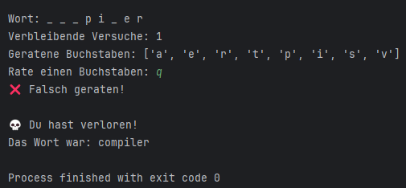

# Sprachenspiel (Python)

Wort-Ratespiel nach dem Galgenmännchen-Prinzip als Konsolenanwendung.
Modulprojekt Python.



## Funktionen

- Vier Sprachen (Deutsch, Englisch, Italienisch, Spanisch) und drei
  Schwierigkeitsgrade; die erlaubten Fehlversuche sinken mit der Schwierigkeit
  (10 / 7 / 5).
- Über 1 100 Wörter in 12 Textdateien unter `words/`, die zur Laufzeit geladen
  werden. Neue Sprachen lassen sich durch eine weitere Datei
  `<sprache>_<stufe>.txt` ergänzen.
- Klasse `Sprachenspiel` kapselt den Spielzustand (Wort, geratene Buchstaben,
  Restversuche); Ein- und Ausgabe liegen in eigenen Funktionen.
- Eingabevalidierung für Sprache, Schwierigkeit und Buchstaben;
  `FileNotFoundError` und `ValueError` für fehlende oder leere Wortlisten.

## Ausführen

Python 3.10 oder neuer, keine externen Abhängigkeiten.

```bash
python sprachenspiel.py
```

## Tests

```bash
python -m unittest discover -s tests -v
```

Die Tests prüfen das Laden der Wortlisten sowie die Spiellogik
(Anzeige, richtige und falsche Buchstaben, Gewinn- und Verlustbedingung).

## Struktur

```text
sprachenspiel.py      Spiel-Logik und Konsolen-Oberfläche
words/                12 Wortlisten (de/en/it/es × leicht/mittel/schwer)
tests/                Unit-Tests (unittest)
screenshots/          Beispielablauf
```
